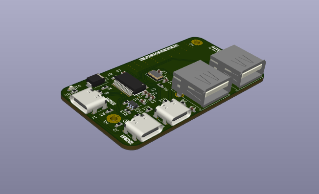
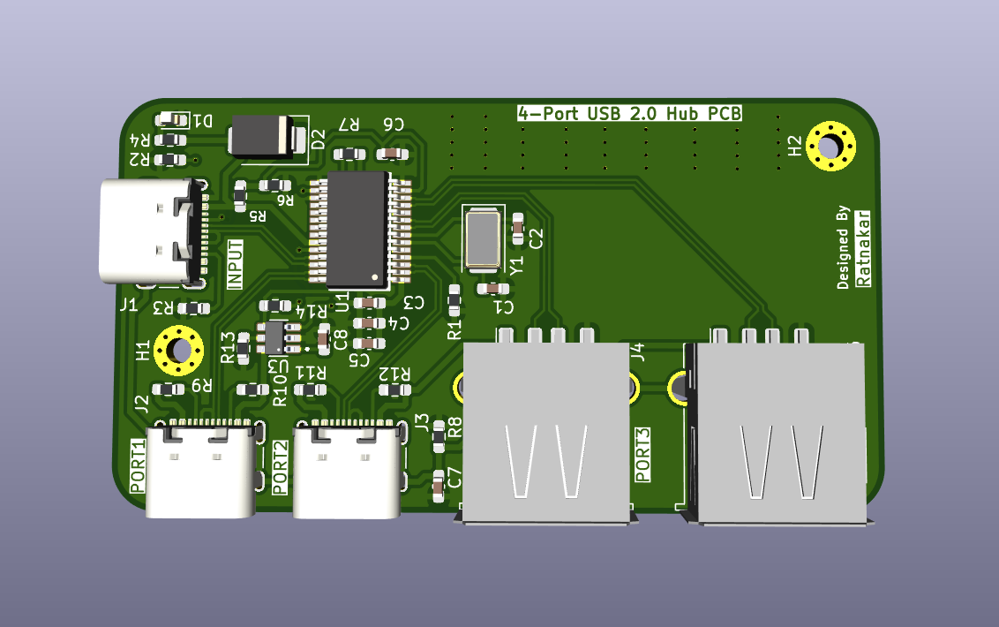
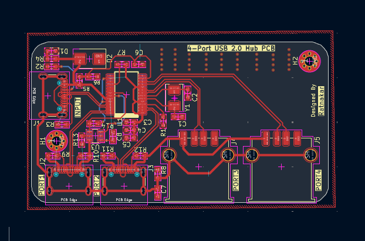
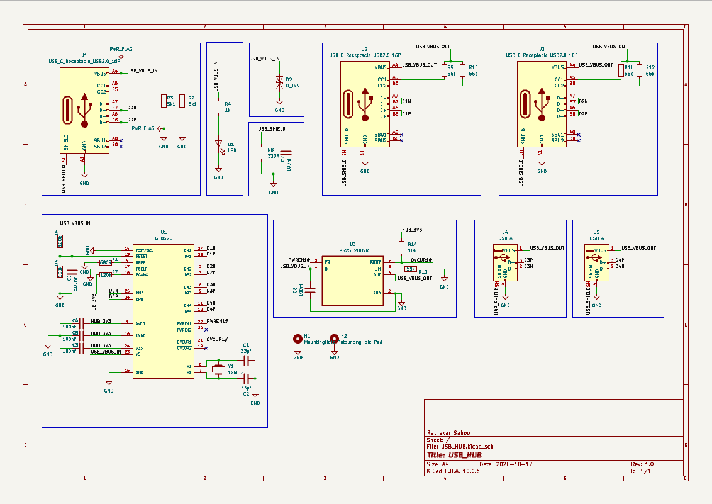

<h1 align="center">4-Port USB 2.0 Hub PCB</h1>

<p align="center">
  <strong>From a simple weekend idea to a custom hardware design.</strong>
  <br>
  A USB hub PCB designed in KiCad featuring USB-C and USB-A connectivity.
</p>

<p align="center">
  
</p>

<p align="center">
  
  
  
  
</p>

---

## Overview

What started as a search for a USB hub to buy turned into a weekend PCB design project.

Instead of purchasing one, I decided to explore the hardware design process myself — studying datasheets, understanding the hub controller and its supporting circuitry, designing the schematic, and routing a custom PCB.

The result is a **4-port USB 2.0 hub design** with a combination of USB-C and USB-A interfaces.

## Hardware Features

| Feature | Specification |
|---|---|
| Hub Controller | GL852G |
| USB Standard | USB 2.0 |
| Upstream Interface | 1 × USB-C |
| Downstream Interfaces | 2 × USB-C + 2 × USB-A |
| Design Tool | KiCad |
| PCB Design | Custom schematic and PCB layout |
| Signal Routing | USB D+ and D− differential pairs |

## PCB Design

### 3D Visualization

<p align="center">
  
</p>

<p align="center">
  
</p>

### PCB Layout

<p align="center">
  
</p>

### Schematic

<p align="center">
  
</p>

## Design and Development

The project involves:

- Studying the GL852G datasheet and understanding the controller's pin configuration.
- Designing the schematic and supporting circuitry.
- Selecting components and assigning footprints.
- Developing the PCB layout in KiCad.
- Routing USB D+ and D− differential pairs with impedance considerations.
- Reviewing connector placement and mechanical dimensions.
- Preparing the design for electrical verification and manufacturing.

## Technology Stack

<p>
  
  
  
  
</p>

## Current Status

**PCB Design — In Progress**

The schematic and PCB layout have been developed, and the board has been visualized in KiCad's 3D viewer.

### Next Steps

- Complete electrical rule checks (ERC) and design rule checks (DRC).
- Verify connector footprints and component dimensions.
- Review power delivery, protection circuitry, and USB signal integrity.
- Finalize the PCB layout for manufacturing.
- Assemble and test the physical prototype.

## Repository Structure

```text
4-Port-USB-2.0-Hub/
├── Hardware/
│   ├── USB_HUB.kicad_pro
│   ├── USB_HUB.kicad_sch
│   └── USB_HUB.kicad_pcb
├── Images/
│   ├── PCB_3D_View.png
│   ├── PCB_3D_View_2.png
│   ├── PCB_Layout.png
│   └── PCB_Schematic.png
├── Libraries/
│   ├── GL852G/
│   ├── TPS2042BDR/
│   ├── TPS2552DBVR/
│   └── TPS2553DBVR/
├── Documentation/
├── .gitignore
└── README.md
